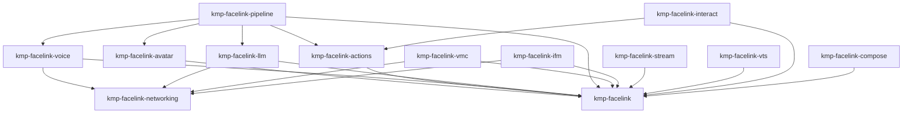

# Architecture

## High-Level Overview

KMP-FaceLink is a modular Kotlin Multiplatform SDK that wraps platform-native tracking engines (MediaPipe on Android, ARKit/Vision on iOS) behind a unified Kotlin API. Extension modules layer avatar mapping, gesture actions, voice, LLM, and protocol output on top of the core tracking layer.

```
┌──────────────────────────────────────────────────────────────┐
│                     Consumer Application                     │
├──────────────────────────────────────────────────────────────┤
│  Pipeline │ Interact │   VMC  │  IFM  │ Stream │    VTS     │
│  (voice→llm→tts→lip→expr)    │ (OSC) │ (UDP) │  (WS)  │ (Plugin) │
├──────────────────────────────────────────────────────────────┤
│    Voice   │   LLM    │  Avatar  │ Actions │  Networking    │
│  (ASR/TTS) │ (cloud+  │ (Live2D, │ (gesture│  (UDP, mDNS)  │
│  (lip sync)│  device) │  VRM)    │  emotion│               │
├──────────────────────────────────────────────────────────────┤
│              kmp-facelink (Core Tracking)                    │
│   Face │ Hand │ Body │ Holistic │ BlendShape │ Smoothing    │
├──────────────────────────────────────────────────────────────┤
│  MediaPipe  │  ARKit/Vision  │  ONNX Runtime  │ MediaPipe JS│
│  (Android)  │    (iOS)       │    (JVM)       │   (Wasm)    │
└──────────────────────────────────────────────────────────────┘
```

## Project Structure

```
KMP-FaceLink/
├── kmp-facelink/                  # Core tracking API (face, hand, body, holistic)
├── kmp-facelink-avatar/           # BlendShape → Live2D / VRM parameter mapping
├── kmp-facelink-actions/          # Gesture triggers, emotion classification, recording
├── kmp-facelink-voice/            # TTS, ASR, multilingual lip sync
├── kmp-facelink-llm/              # LLM streaming (cloud + on-device + hybrid)
├── kmp-facelink-pipeline/         # AI avatar pipeline orchestration
├── kmp-facelink-networking/       # Shared UDP socket, time utils, mDNS discovery
├── kmp-facelink-vmc/              # VMC Protocol (OSC over UDP) sender/receiver
├── kmp-facelink-ifm/              # iFacialMocap protocol output
├── kmp-facelink-stream/           # WebSocket streaming server
├── kmp-facelink-vts/              # VTube Studio Plugin API integration
├── kmp-facelink-interact/         # Stream interaction (Twitch, YouTube chat events)
├── kmp-facelink-compose/          # Compose Multiplatform remember helpers for trackers
├── kmp-facelink-bom/              # Bill of Materials for version alignment
├── kmp-facelink-cbridge/          # C interop bridge for native bindings
│
├── androidApp/                    # Android sample app (Jetpack Compose)
├── iosApp/                        # iOS sample app (SwiftUI + XcodeGen)
├── sampleShared/                  # Shared Compose Multiplatform sample UI
│
├── react-native-kmp-facelink/     # React Native bridge (TypeScript + Kotlin)
├── unity-plugin/                  # Unity integration package (C# bindings)
├── gradle-plugin/                 # Internal Gradle plugin for build automation
│
├── docs/                          # User and developer documentation
│   ├── quick-start-android.md
│   ├── quick-start-ios.md
│   ├── quick-start-integration.md
│   ├── api-overview.md
│   ├── publishing.md
│   ├── migration.md
│   ├── troubleshooting.md
│   ├── on-device-llm.md
│   ├── extension-strategy.md
│   ├── design/                    # Architecture diagrams
│   └── research/                  # Experimental feature research
│
├── scripts/                       # Utility scripts (ML quantization, SPM generation)
├── tools/                         # Training and calibration tools
├── maestro/                       # Maestro E2E test flows
├── whisper/                       # Whisper speech-to-text integration
├── whisper.cpp/                   # Whisper C++ backend
├── live2d/                        # Live2D SDK integration artifacts
│
├── llms.txt                       # LLM-friendly project overview
├── llms-full.txt                  # Full API reference for LLMs
├── Package.swift                  # SPM distribution for iOS
└── .github/workflows/             # CI/CD pipelines
```

## Module Dependency Graph



## Module Details

| Module | Targets | Stability | Description |
|--------|---------|-----------|-------------|
| `kmp-facelink` | Android, iOS, JVM, Wasm | **Stable** | Core face/hand/body tracking with N-euro Predictor smoothing |
| `kmp-facelink-avatar` | Android, iOS, Wasm | **Stable** | BlendShape → Live2D / VRM / VRChat parameter mapping |
| `kmp-facelink-actions` | Android, iOS, Wasm | **Stable** | Gesture triggers, emotion classification, tracking recording |
| `kmp-facelink-voice` | Android, iOS | **Experimental** | TTS (OpenAI, ElevenLabs, Voicevox), ASR (Whisper), lip sync |
| `kmp-facelink-llm` | Android, iOS | **Experimental** | LLM streaming with cloud, on-device (llama.cpp, Apple FM), and hybrid routing |
| `kmp-facelink-pipeline` | Common only | **Experimental** | Voice → LLM → TTS → LipSync → Expression orchestration |
| `kmp-facelink-networking` | Android, iOS | **Stable** | Shared UDP socket, mDNS/NSD discovery |
| `kmp-facelink-vmc` | Common only | **Stable** | VMC Protocol (OSC over UDP) for VRM apps |
| `kmp-facelink-ifm` | Common only | **Stable** | iFacialMocap protocol output for VTube Studio |
| `kmp-facelink-stream` | JVM only | **Experimental** | WebSocket/WebRTC streaming server |
| `kmp-facelink-vts` | JVM only | **Stable** | VTube Studio Plugin API via WebSocket |
| `kmp-facelink-interact` | Common only | **Stable** | Stream event aggregation (Twitch EventSub, YouTube Live Chat) |
| `kmp-facelink-compose` | Android, iOS | **Stable** | Compose Multiplatform `remember*` helpers for tracker lifecycle |
| `kmp-facelink-bom` | — | **Stable** | Bill of Materials (dependency version alignment) |

## Source Set Layout

Each library module follows this pattern:

```
<module>/src/
  ├── commonMain/      # Shared API and logic
  ├── commonTest/      # Unit tests
  ├── androidMain/     # Android platform implementation
  ├── iosMain/         # iOS platform implementation
  ├── jvmMain/         # JVM/ONNX implementation (core only)
  ├── nonMobileMain/   # Shared JVM + Wasm no-op stubs
  └── wasmJsMain/      # Wasm/JS via MediaPipe JS interop
```

## Platform Implementations

### Android (MediaPipe + CameraX)

| Tracker | Engine | Details |
|---------|--------|---------|
| Face | `MediaPipeFaceTracker` | Face Landmarker → ARKit-compatible blend shapes |
| Hand | `MediaPipeHandTracker` | Hand Landmarker with gesture classification |
| Body | `MediaPipeBodyTracker` | Pose Landmarker |
| Camera | `CameraXManager` | `ImageProxyConverter` + `BitmapPool` for bitmap reuse |
| Voice | `WhisperCppBridge` | JNI bindings + Android AudioRecord/AudioTrack |
| LLM | `LlamaCppEngine` | llama.cpp JNI for on-device inference |

### iOS (ARKit + Vision)

| Tracker | Engine | Details |
|---------|--------|---------|
| Face | `ARKitFaceTracker` | ARFaceTrackingConfiguration (TrueDepth) |
| Hand | `VisionHandTracker` | VNDetectHumanHandPoseRequest + AVCaptureSession |
| Body | `VisionBodyTracker` | VNDetectHumanBodyPose3DRequest + AVCaptureSession |
| Voice | `WhisperCppBridge` | Native bindings + AVFoundation |
| LLM | `FoundationModelsProvider` | Apple Foundation Models (iOS 26+) |

### JVM (ONNX Runtime)

Face tracking via ONNX Runtime + JavaCV. Hand and body tracking are no-op stubs.

### Wasm (MediaPipe JS)

Face tracking via MediaPipe JS interop with gaze estimation. Hand and body tracking are no-op stubs. Avatar mapping and action triggers are fully functional.

## Cross-Platform Bridges

| Bridge | Location | Purpose |
|--------|----------|---------|
| React Native | `react-native-kmp-facelink/` | TypeScript bindings with native modules for Android/iOS |
| Unity | `unity-plugin/` | C# facade (`FaceLinkUnityFacade`) with UPM package format |
| C Bridge | `kmp-facelink-cbridge/` | C interop layer for native binding generation |

## Build System

- **Gradle** (Kotlin DSL) with 16 subprojects
- **Kotlin 2.3.10** with `explicitApi()` on all library modules
- **SKIE 0.10.10** for Swift-Kotlin Flow bridging on iOS
- **Detekt** for static analysis (60-line method limit, strict import ordering)
- **Dokka** for API documentation (deployed to GitHub Pages)
- **Binary Compatibility Validator** for public API tracking
- **Kover** for code coverage reporting
- **Nexus Publish** for Maven Central releases
- **SPM** via `Package.swift` for iOS distribution

## Key Design Decisions

- **BlendShape naming**: ARKit conventions (52 parameters). MediaPipe landmarks are mapped to ARKit-compatible names
- **Data streaming**: Always `Flow<T>`, never callbacks
- **Thread safety**: `PlatformLock` (ReentrantLock on Android, NSLock on iOS) + `AtomicInt`
- **Head transform**: Right-handed coordinate system
- **Performance target**: 30-60fps real-time tracking with smoothing filters
- **Renderer-agnostic output**: The SDK outputs parameters, not visuals. Rendering is the consumer's responsibility
