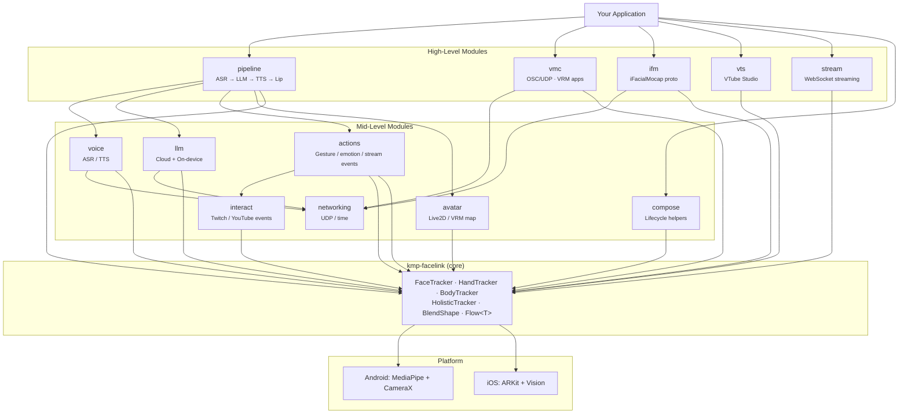
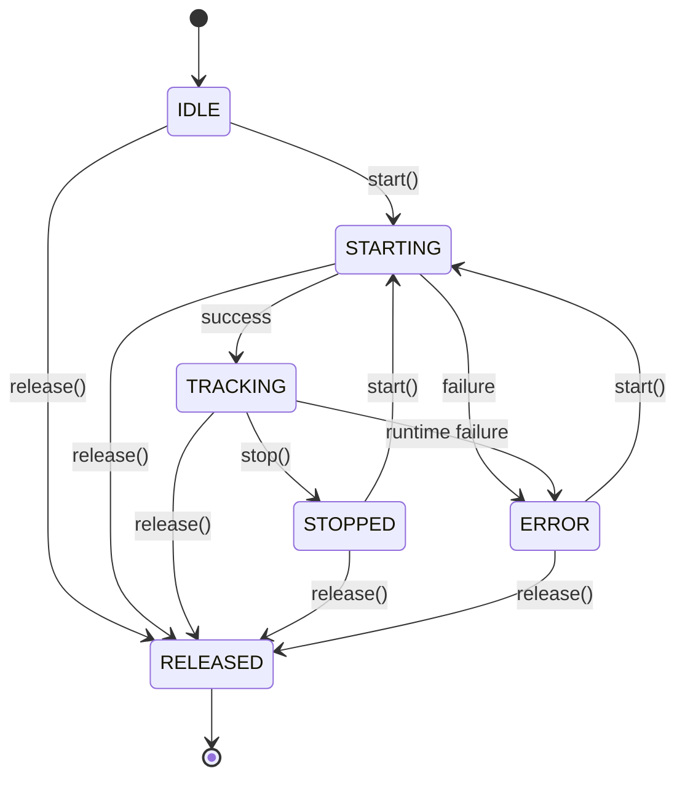

# API Overview

KMP-FaceLink is a modular Kotlin Multiplatform SDK for real-time face, hand, and body tracking with extension modules for avatar driving, gesture actions, voice, LLM integration, and protocol output.

## Architecture



## Modules

### Core: `kmp-facelink`

Real-time face, hand, and body tracking with a unified API across platforms.

| API | Description |
|-----|-------------|
| `createFaceTracker(context, config)` | 52 ARKit-compatible blend shapes + head transform |
| `createHandTracker(context, config)` | Hand landmarks + gesture classification |
| `createBodyTracker(context, config)` | Body pose landmarks (33 keypoints) |
| `createHolisticTracker(context, config)` | Simultaneous face + hands + body with shared camera |

**Android model setup:** The Android implementation uses MediaPipe models that must be bundled in your app's assets. See [Quick Start: Android — Model Setup](quick-start-android.md#2-model-setup) for download instructions and APK size guidance.

All trackers follow the same pattern:

```kotlin
val tracker = createFaceTracker(platformContext, FaceTrackerConfig())
tracker.start()
tracker.trackingData.collect { data -> /* use data */ }
tracker.stop()
tracker.release()
```

**Key types:**
- `FaceTrackingData` — blend shapes, head transform, face landmarks, tracking state
- `HandTrackingData` — per-hand landmarks, gesture, handedness (`LEFT`, `RIGHT`, or `UNKNOWN`)
- `BodyTrackingData` — body pose landmarks, tracking confidence
- `HolisticTrackingData` — combined face + hands + body
- `TrackingState` — `IDLE`, `STARTING`, `TRACKING`, `STOPPED`, `ERROR`, `RELEASED`
- `BlendShape` — enum of 52 ARKit blend shape parameters

### Avatar: `kmp-facelink-avatar`

Maps tracking data to avatar engine parameters.

```kotlin
// Live2D
val mapper = Live2DParameterMapper()
faceTracker.trackingData.collect { data ->
    val params: Map<String, Float> = mapper.map(data)
    // params["ParamAngleX"], params["ParamEyeLOpen"], params["ParamMouthOpenY"], ...
}

// VRM (0.x and 1.0)
val vrmMapper = VrmParameterMapper(version = VrmVersion.V1_0)
faceTracker.trackingData.collect { data ->
    val expressions: Map<String, Float> = vrmMapper.map(data)
    // expressions["happy"], expressions["lookLeft"], ...
}
```

### Actions: `kmp-facelink-actions`

Gesture and expression trigger system with debounce, cooldown, and emotion classification.

```kotlin
val actionSystem = ActionSystem()

// Register a gesture trigger
actionSystem.register(
    ActionBinding(
        actionId = "victory",
        trigger = GestureTrigger(gesture = HandGesture.VICTORY),
        holdTimeMs = 500,
        cooldownMs = 1000,
    )
)

// Register an expression trigger
actionSystem.register(
    ActionBinding(
        actionId = "left-blink",
        trigger = ExpressionTrigger(
            blendShape = BlendShape.EYE_BLINK_LEFT,
            threshold = 0.8f,
        ),
    )
)

// Collect action events
actionSystem.events.collect { event ->
    println("Action fired: ${event.actionId}")
}

// Feed tracking data
faceTracker.trackingData.collect { actionSystem.processFace(it) }
handTracker.trackingData.collect { actionSystem.processHand(it) }
```

**Emotion classification** (FACS-based cosine similarity):

```kotlin
val classifier = EmotionClassifier()
faceTracker.trackingData.collect { data ->
    val result: EmotionResult = classifier.classify(data.blendShapes)
    println("${result.emotion}: ${result.confidence}")  // e.g., "happy: 0.87"
}
```

### Voice: `kmp-facelink-voice`

ASR (speech-to-text), TTS (text-to-speech), and lip sync.

```kotlin
val voicePipeline = VoicePipeline(config)

// Text-to-speech with lip sync blend shapes
voicePipeline.speak("Hello, world!").collect { lipSyncFrame ->
    // lipSyncFrame.blendShapes — mouth shapes synchronized to audio
}

// Speech recognition
voicePipeline.startListening()
voicePipeline.transcriptions.collect { text ->
    println("User said: $text")
}
```

**Supported backends:**
- ASR: Whisper (on-device via whisper.cpp)
- TTS: OpenAI TTS, ElevenLabs, Voicevox (on-device)

### LLM: `kmp-facelink-llm`

Streaming LLM API with cloud, on-device, and hybrid routing.

```kotlin
// Cloud LLM
val client = LlmClient.create(
    LlmConfig.OpenAi(apiKey = "sk-...", model = "gpt-4o-mini")
)

// On-device LLM (Gemma 3n, llama.cpp)
val onDevice = LlmClient.create(
    LlmConfig.OnDevice(modelId = "gemma-3n-e2b-int4")
)

// Hybrid: auto-routes simple queries to on-device, complex to cloud
val hybrid = LlmClient.create(
    LlmConfig.Hybrid(
        onDeviceConfig = LlmConfig.OnDevice(modelId = "gemma-3n-e2b-int4"),
        cloudConfig = LlmConfig.OpenAi(apiKey = "sk-..."),
        routingStrategy = RoutingStrategy.Auto(complexityThreshold = 0.5f),
    )
)

// Streaming chat
val history = ConversationHistory()
history.addUser("Hello!")
client.chat(history).collect { token -> print(token) }
```

See [On-Device LLM](on-device-llm.md) for model details, benchmarks, and setup.

### Pipeline: `kmp-facelink-pipeline`

Orchestrates the full AI avatar pipeline: ASR -> LLM -> TTS -> LipSync -> Expression.

```kotlin
val pipeline = buildAvatarPipeline {
    llm(LlmConfig.OpenAi(apiKey = "sk-...", model = "gpt-4o-mini"))
    persona(PersonaConfig(name = "Ai", systemPrompt = "You are a friendly assistant"))
    ttsEngine(myTtsEngine)
    lipSyncEngine(myLipSyncEngine)
    expressionBlendRatio(0.7f)
}

pipeline.start()

// Voice input mode
pipeline.listen()  // ASR -> LLM -> TTS -> lip sync

// Text input mode
pipeline.processText("Tell me a joke")

// Collect avatar output for rendering
pipeline.output.collect { frame ->
    // frame.blendShapes — combined tracking + lip sync + emotion
    // frame.audioChunk — TTS audio to play
    // frame.text — LLM response text
}
```

### Protocol Output Modules

#### VMC: `kmp-facelink-vmc`

Send tracking data to VRM applications (VSeeFace, VMagicMirror, etc.) via VMC Protocol (OSC over UDP).

```kotlin
val sender = VmcSender(VmcConfig(host = "192.168.1.100", port = 39539))
sender.start(faceTracker.trackingData, coroutineScope)

// Or send pre-mapped VRM expressions
val vrmMapper = VrmParameterMapper(version = VrmVersion.V1_0)
val expressionFlow = faceTracker.trackingData.map { vrmMapper.map(it) }
sender.startWithExpressions(expressionFlow, coroutineScope)

// Receive VMC data from other apps
val receiver = VmcReceiver(VmcConfig(port = 39539))
receiver.start(coroutineScope)
receiver.messages.collect { message -> /* handle VMC messages */ }
```

#### iFacialMocap: `kmp-facelink-ifm`

Send tracking data using the iFacialMocap protocol (compatible with VTube Studio as a MeowFace replacement).

#### WebSocket Stream: `kmp-facelink-stream`

Stream tracking data over WebSocket for phone-as-tracker use cases.

#### VTube Studio: `kmp-facelink-vts`

Direct integration with VTube Studio's Plugin API via WebSocket.

### Networking: `kmp-facelink-networking`

Shared UDP socket and time utilities used by protocol modules (VMC, iFacialMocap). Not typically used directly by app developers.

## Common Use Cases

### VTuber Avatar Driving

```kotlin
// Track face -> map to Live2D params -> drive avatar
val tracker = createFaceTracker(context, FaceTrackerConfig())
val mapper = Live2DParameterMapper()

tracker.start()
tracker.trackingData.collect { data ->
    val params = mapper.map(data)
    // Feed params to your Live2D renderer
    live2dModel.setParameterValues(params)
}
```

### Phone as Wireless Tracker

```kotlin
// On phone: track + send to desktop via VMC
val tracker = createFaceTracker(context)
val sender = VmcSender(VmcConfig(host = "192.168.1.100"))
sender.start(tracker.trackingData, scope)
```

### AI Avatar Chatbot

```kotlin
// Full pipeline: listen -> think -> speak -> animate
val pipeline = buildAvatarPipeline {
    llm(LlmConfig.Hybrid(
        onDeviceConfig = LlmConfig.OnDevice(modelId = "gemma-3n-e2b-int4"),
        cloudConfig = LlmConfig.OpenAi(apiKey = "sk-..."),
        routingStrategy = RoutingStrategy.Auto(complexityThreshold = 0.5f),
    ))
    persona(PersonaConfig(name = "Assistant"))
}
pipeline.start()
pipeline.listen()
pipeline.output.collect { frame -> /* render avatar + play audio */ }
```

### Gesture-Controlled Actions

```kotlin
val actions = ActionSystem()
actions.register(
    ActionBinding(
        actionId = "thumb-up",
        trigger = GestureTrigger(HandGesture.THUMB_UP),
        holdTimeMs = 300,
    )
)
actions.events.collect { event ->
    when (event.actionId) { /* handle actions */ }
}
handTracker.trackingData.collect { actions.processHand(it) }
```

## Threading Model

All tracker Flows (`trackingData`, `state`, `errorMessage`) emit on **platform-specific background threads**, not the Main/UI thread. This applies to every tracker type: `FaceTracker`, `HandTracker`, `BodyTracker`, and `HolisticTracker`.

### Platform Details

| Platform | Emission Thread | Reason |
|----------|----------------|--------|
| Android | CameraX background executor | MediaPipe inference runs on a dedicated executor to avoid blocking the UI thread |
| iOS | ARKit session delegate thread / AVCaptureSession output queue | ARKit and Vision callbacks arrive on their own serial dispatch queues |

### Safe Collection for UI Updates

Consumers must switch to the Main dispatcher before touching UI components.

**Kotlin (Android / Shared)**

```kotlin
// Option 1: withContext inside collect
lifecycleScope.launch {
    tracker.trackingData.collect { data ->
        // Process data on the background thread
        val params = mapper.map(data)
        withContext(Dispatchers.Main) {
            // Update UI on the Main thread
            viewModel.updateParams(params)
        }
    }
}

// Option 2: flowOn + stateIn for Compose
val uiState = tracker.trackingData
    .map { mapper.map(it) }
    .stateIn(viewModelScope, SharingStarted.WhileSubscribed(), emptyMap())
// Compose collectAsState() observes on Main automatically
```

**Swift (iOS)**

```swift
// SKIE bridges Flow to AsyncSequence automatically
Task {
    for await data in tracker.trackingData {
        // Dispatch to MainActor for UI updates
        await MainActor.run {
            self.blendShapes = data.blendShapes
        }
    }
}
```

### Rules of Thumb

- **Never** call UIKit/SwiftUI/Compose UI APIs directly inside a `collect {}` block without switching to Main first.
- Heavy processing (avatar mapping, action system evaluation) is fine to keep on the background emission thread.
- `StateFlow.value` reads are thread-safe and can be accessed from any thread without dispatching.

## Error Recovery

All trackers share the same `TrackingState` lifecycle. When something goes wrong, the state transitions to `ERROR` and `errorMessage` contains a platform-specific description.

### State Transition Diagram



### Valid Operations per State

| State | `start()` | `stop()` | `release()` | `updateSmoothing()` | `resetSmoothing()` | `switchCamera()` |
|-------|-----------|----------|-------------|---------------------|-------------------|-----------------|
| IDLE | Yes | No-op | Yes | Yes | Yes | Yes |
| STARTING | No-op | Yes | Yes | Yes | Yes | Yes |
| TRACKING | No-op | Yes | Yes | Yes | Yes | Yes |
| STOPPED | Yes | No-op | Yes | Yes | Yes | Yes |
| ERROR | **Yes** | No-op | Yes | Yes | Yes | Yes |
| RELEASED | Throws `IllegalStateException` | Throws | -- | Throws | Throws | Throws |

### Error Categories

Errors fall into two categories based on whether retrying `start()` can succeed.

#### Recoverable (retry may succeed)

These are transient conditions that may resolve on their own:

| Error | Platform | Typical `errorMessage` | Recovery |
|-------|----------|----------------------|----------|
| Camera in use by another app | Android/iOS | `"CameraX binding failed..."` / ARKit session error | Wait for the other app to release the camera, then call `start()` |
| Temporary permission denial | Android | `"No front camera available"` (after permission revoke) | Request permission again, then call `start()` |
| ARKit session interruption | iOS | ARKit `NSError.localizedDescription` | ARKit session may recover after interruption ends; call `start()` |

#### Fatal (must recreate tracker)

These indicate a permanent condition that retrying cannot fix:

| Error | Platform | Typical `errorMessage` | Recovery |
|-------|----------|----------------------|----------|
| No camera hardware | Android | `"No front camera available"` | Cannot recover on this device |
| ARKit face tracking unsupported | iOS | `"ARFaceTracking is not supported on this device"` | Cannot recover on this device/OS combination |
| MediaPipe model load failure | Android | `"Failed to create FaceLandmarker..."` | Check model assets are bundled correctly; app bug |
| Platform not supported | Wasm holistic path | `"Face tracking is not yet implemented on this platform"` | No native implementation available |
| Pinned ONNX resource missing/mismatched | JVM | `"Model resource not found..."` / `"Model digest mismatch..."` | Rebuild the artifact after the pinned model setup; do not retry camera startup |

> **Distinguishing recoverable from fatal:** There is no programmatic flag. Use the `errorMessage` content and the device context to decide. A practical approach: allow a fixed number of retries with exponential backoff, then show the user an error UI with the message.

### Recovery Patterns

#### Kotlin (Android / Shared)

```kotlin
// Observe state and show error UI with retry
lifecycleScope.launch {
    tracker.state.collect { state ->
        when (state) {
            TrackingState.ERROR -> {
                val message = tracker.errorMessage.value
                showErrorBanner(message, onRetry = {
                    lifecycleScope.launch { tracker.start() }
                })
            }
            TrackingState.TRACKING -> hideErrorBanner()
            else -> { /* handle other states */ }
        }
    }
}

// Retry with exponential backoff
suspend fun startWithRetry(tracker: FaceTracker, maxRetries: Int = 3) {
    var attempt = 0
    while (attempt < maxRetries) {
        try {
            tracker.start()
            return // Success
        } catch (e: UnsupportedOperationException) {
            throw e // Fatal — no point retrying
        } catch (e: Exception) {
            attempt++
            if (attempt >= maxRetries) throw e
            delay(1000L * (1 shl (attempt - 1))) // 1s, 2s, 4s
        }
    }
}
```

#### Swift (iOS)

```swift
// Observe state and retry
func observeTracker() {
    trackingTask = Task {
        for await state in tracker.state {
            await MainActor.run {
                switch state {
                case .error:
                    let message = tracker.errorMessage.value ?? "Unknown error"
                    self.showError(message)
                case .tracking:
                    self.hideError()
                default:
                    break
                }
            }
        }
    }
}

// Retry with backoff
func startWithRetry(maxRetries: Int = 3) async throws {
    for attempt in 0..<maxRetries {
        do {
            try await tracker.start()
            return // Success
        } catch is UnsupportedOperationException {
            throw error // Fatal — no point retrying
        } catch {
            if attempt == maxRetries - 1 { throw error }
            try await Task.sleep(nanoseconds: UInt64(pow(2.0, Double(attempt))) * 1_000_000_000)
        }
    }
}
```

### Important Notes

- **`start()` throws on error.** When `start()` fails, it both sets `state` to `ERROR` and throws the exception. Callers should use `try`/`catch` if they want to handle the error inline, or observe `state` for reactive error handling.
- **`errorMessage` is not cleared on retry.** After a failed `start()`, `errorMessage` retains the last error description even if a subsequent `start()` succeeds. Use `state` (not `errorMessage == null`) to determine the current condition.
- **`release()` is always safe.** It can be called from any state, including ERROR, and transitions to RELEASED. After releasing, create a new tracker instance to continue.

## Smoothing Filters

All trackers support runtime-configurable smoothing:

| Filter | Best For | Parameters |
|--------|----------|------------|
| `SmoothingConfig.None` | Raw data, debugging | — |
| `SmoothingConfig.Ema(alpha)` | General use | `alpha`: 0-1 (higher = less smoothing) |
| `SmoothingConfig.OneEuro(...)` | Low latency + jitter removal | `minCutoff`, `beta`, `dCutoff` |
| `SmoothingConfig.CategoryAware(...)` | Per-region tuning | Separate OneEuro params per facial region |

```kotlin
tracker.updateSmoothing(SmoothingConfig.OneEuro(minCutoff = 1.0f, beta = 0.007f))
```

## API Reference (Dokka)

KDoc API reference can be generated locally:

```bash
./gradlew dokkaHtml
```

Output is at `build/dokka/html/index.html`. The reference covers all public APIs across all modules.

## Further Reading

- [Quick Start: Android](quick-start-android.md)
- [Quick Start: iOS](quick-start-ios.md)
- [On-Device LLM](on-device-llm.md) — model selection, benchmarks, hybrid routing
- [Extension Strategy](extension-strategy.md) — module architecture and design
