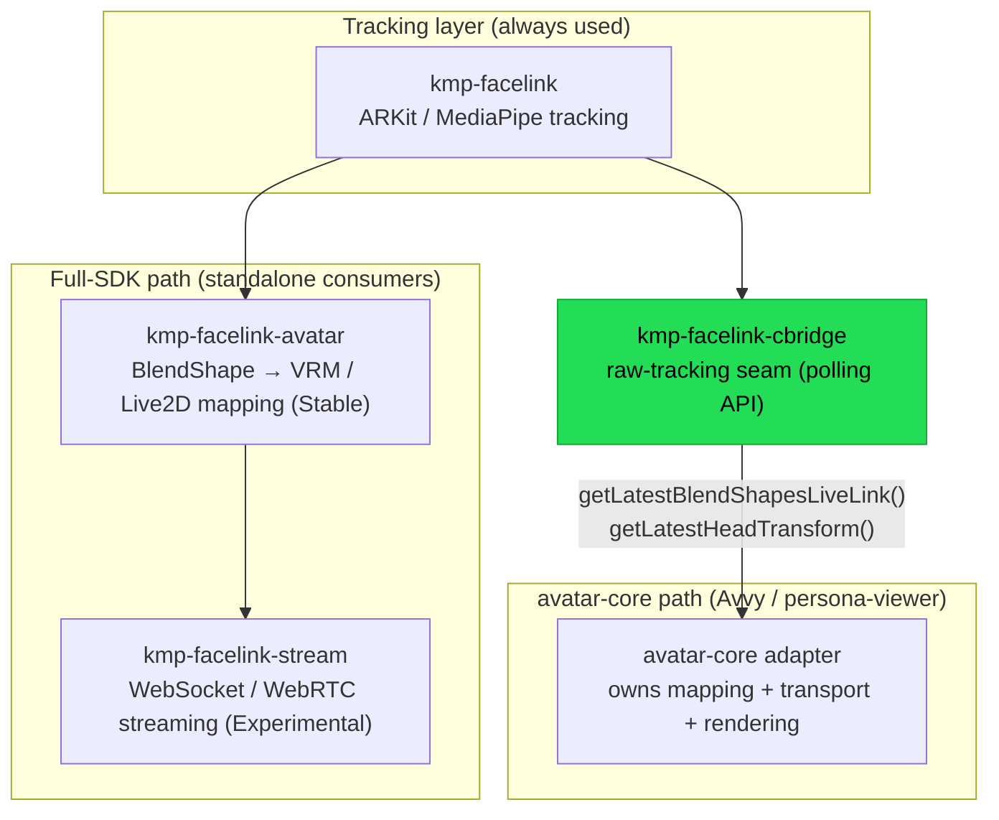

# avatar-core Raw-Tracking Seam

This document records how KMP-FaceLink fits into the Avvy avatar pipeline, following the
2026-07-09 cross-repo design decision. It exists so future contributors do not
re-derive the seam or accidentally break it.

## TL;DR

- **KMP-FaceLink is a full, standalone VTuber SDK.** It is not "just a tracker for
  avatar-core." Consumers who do **not** use avatar-core keep using the whole stack:
  tracking → `kmp-facelink-avatar` (VRM / Live2D / VRChat param mapping) →
  `kmp-facelink-stream` (streaming).
- **Consumers that use avatar-core** (e.g. Avvy via persona-viewer) tap the
  **cbridge raw-tracking output only**. avatar-core owns mapping, transport, and
  rendering, so the KMP-FaceLink downstream (`kmp-facelink-avatar` /
  `kmp-facelink-stream`) is **not used by them**.
- This is **"downstream optional", not "downstream removed".** Both consumption modes
  are first-class and supported side by side.

## Layered pipeline



ASCII layer stack (top = consumer, bottom = tracker):

```
                    Full-SDK consumer            avatar-core consumer (Avvy)
                    ┌───────────────────┐        ┌────────────────────────────┐
   downstream       │ kmp-facelink-     │        │  avatar-core owns:         │
   (optional for    │ stream            │        │  mapping / transport /     │
    avatar-core)    │ (streaming)       │        │  rendering                 │
                    ├───────────────────┤        └──────────────┬─────────────┘
                    │ kmp-facelink-     │                       │ raw tracking only
                    │ avatar (mapping)  │                       │
                    └─────────┬─────────┘                       │
                              │              ┌──────────────────┴───┐
                              │              │ kmp-facelink-cbridge │  ◄── the SEAM
                              │              │ (polling raw API)    │
                              │              └──────────┬───────────┘
                    ┌─────────┴────────────────────────┴─────────┐
                    │ kmp-facelink  (ARKit / MediaPipe tracking)  │
                    └─────────────────────────────────────────────┘
```

## The seam: cbridge raw-tracking API

avatar-core consumers integrate at exactly one point — the cbridge polling API. They
read the latest tracking frame and do their own mapping/rendering downstream.

| API (Android facade / C entry point) | Returns | Used by |
|---|---|---|
| `getLatestBlendShapesLiveLink()` / `KmpFaceLink_GetLatestBlendShapesLiveLink` | `float[52]` in ARKit Live Link Face wire order | **avatar-core** and other Live Link consumers |
| `getLatestHeadTransform()` / `KmpFaceLink_GetLatestHeadTransform` | `float[6]` `[pitch, yaw, roll, posX, posY, posZ]` | **avatar-core** and other head-pose consumers |
| `getLatestBlendShapes()` / `KmpFaceLink_GetLatestBlendShapes` | `float[52]` in legacy `BlendShape.ordinal` (anatomical) order | Existing Unity / React Native / Flutter consumers (stable binary contract) |

> avatar-core taps the **Live Link–ordered** blendshape variant
> (`getLatestBlendShapesLiveLink`). The legacy `getLatestBlendShapes` remains the
> unchanged binary contract for existing Unity/RN/Flutter consumers. Both are `float[52]`;
> only the meaning of each index differs. See
> [`kmp-facelink-cbridge/README.md`](../kmp-facelink-cbridge/README.md#blendshape-ordering).

## The seam contract

The contract below is the single cross-repo source of truth. It is asserted from **both
sides** against a shared golden fixture so it cannot silently drift.

### Blendshapes

- **Order:** ARKit Live Link Face wire order (index 0 = `eyeBlinkLeft` … index 51 =
  `tongueOut`), identical to Unreal Engine's `ELiveLinkFaceBlendShape` enum and the
  Live Link Face CSV/UDP column order.
- **Name-keyed, not ordinal:** channels are mapped by `BlendShape.arKitName`, never by
  enum ordinal.
- **0-fill for absent channels:** channels the active tracker does not produce (e.g.
  `tongueOut` on Android/MediaPipe) are emitted as `0.0`.

### Head transform

- **Layout:** `[pitch, yaw, roll, posX, posY, posZ]` (6 floats).
- **Rotation unit: degrees** (Euler, ZYX extraction order) — **not** radians.
- **Position unit: meters**, right-handed (+X right, +Y up, −Z forward).
- **Identity baseline:** a neutral pose yields `[0, 0, 0, 0, 0, 0]`; no auto re-centering.
- **Consumer-side conversion:** degrees→radians (`deg × π/180`) and any axis remapping are
  performed by the consumer adapter (avatar-core), **not** by the bridge.
  Example: `yaw = 10°` → `0.17453293 rad`.

Full field-by-field definition (handedness, origin, per-platform matrix source):
[`kmp-facelink-cbridge/README.md` → Head transform contract](../kmp-facelink-cbridge/README.md#head-transform-contract).

## Shared conformance fixture

The seam is pinned by a golden fixture asserted by **both** KMP-FaceLink and the
avatar-core adapter:

- Fixture: [`kmp-facelink-cbridge/conformance/live_link_conformance.json`](../kmp-facelink-cbridge/conformance/live_link_conformance.json)
- Format & cases: [`kmp-facelink-cbridge/conformance/README.md`](../kmp-facelink-cbridge/conformance/README.md)

Representative cases: `identity` (neutral → all-zero), `jaw_open_full` (`jawOpen = 1.0`
lands on Live Link channel 17 by name), `mediapipe_no_tongue` (absent `tongueOut` →
channel 51 0-filled), `head_yaw_10deg` (`10°` at the bridge → `0.17453293 rad` at the
consumer), and `head_translate_x_0p1m` (`+0.1 m` passed through unchanged).

## References

- Seam contract issue: [#944](https://github.com/rioX432/KMP-FaceLink/issues/944)
  — Live Link 52-ordered, name-keyed lowering API + head-transform units contract.
- This document's issue: [#945](https://github.com/rioX432/KMP-FaceLink/issues/945).
- Bridge overview: [`kmp-facelink-cbridge/README.md`](../kmp-facelink-cbridge/README.md).
