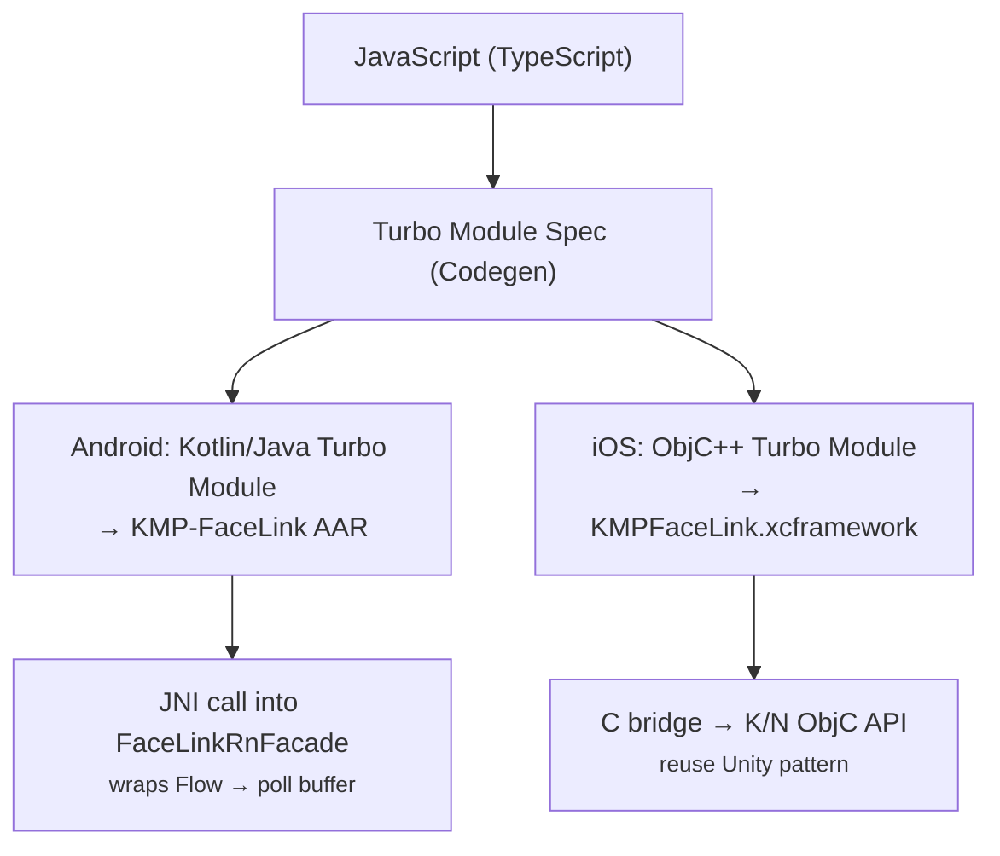
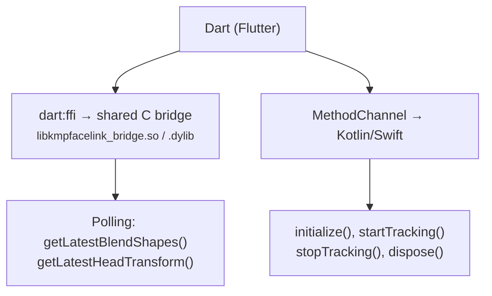

# React Native and Flutter Wrapper Packages Research

**Issue:** #602
**Status:** Research complete
**Date:** 2026-04-06 (updated from initial #477 research on 2026-04-02)

## Executive Summary

This document evaluates creating official wrapper packages for React Native (Turbo Module) and Flutter (Platform Channel / FFI) to expose KMP-FaceLink's tracking capabilities to those ecosystems. KMP-FaceLink already produces AAR (Android) and XCFramework (iOS) artifacts, and the existing Unity plugin demonstrates a proven polling-based bridge pattern that can be adapted for both frameworks.

**Key finding:** Both wrappers are feasible. React Native's Turbo Module with JSI ArrayBuffer support enables zero-copy binary data transfer at 60fps. Flutter's dart:ffi approach bypasses platform channel overhead entirely, matching native performance. A shared binary protocol (flat float arrays, ~242 bytes per face frame) already exists in the Unity plugin and can be reused. Estimated effort: ~3 weeks each for RN and Flutter, plus ~3 days for shared C bridge extraction.

**Ecosystem update (April 2026):** React Native 0.82+ has permanently removed the old bridge architecture — New Architecture (Turbo Modules + JSI) is now the only option. Flutter 3.38+ stabilized build hooks and `package:ffi` native assets (current stable: 3.41.5). Both frameworks are now in an ideal state for high-performance native module wrappers.

**Prioritization:** React Native first, based on VTuber developer community analysis (see Section 9).

---

## 1. Current KMP Artifacts and Bridge Pattern

### Available Artifacts

| Platform | Artifact | Distribution |
|---|---|---|
| Android | AAR (`kmp-facelink-release.aar`) | Maven Central / local |
| iOS | XCFramework (`KMPFaceLink.xcframework`) | Swift Package Manager |

### Unity Plugin Bridge Pattern (Reference)

The existing Unity plugin establishes a proven bridge architecture:

- **Polling model:** Native code collects Flow emissions on background threads and buffers the latest frame. The consumer (Unity `Update()`) polls per-frame.
- **Android path:** C# -> AndroidJavaObject (JNI) -> Kotlin AAR `FaceLinkUnityFacade`
- **iOS path:** C# -> DllImport("__Internal") -> C bridge (`KmpFaceLinkBridge.m`) -> K/N ObjC API
- **Data format:** Raw float arrays (52 floats for blend shapes, 6 floats for head transform, 63 floats per hand)
- **Thread safety:** `os_unfair_lock` (iOS), JNI-safe polling (Android)

This pattern directly informs the RN and Flutter wrapper designs.

---

## 2. React Native Turbo Module Approach

### Architecture



### Data Transfer Strategy

**Option A: JSI ArrayBuffer (recommended)**

- Turbo Modules with JSI bindings can share `ArrayBuffer` directly with JS without serialization
- Performance: ~1ms for 8MB payload vs ~666ms with base64 (per RN benchmarks)
- For face tracking: 52 floats (208 bytes) + 6 floats (24 bytes) = 232 bytes per frame — trivially fast
- Requires implementing `RCTTurboModuleWithJSIBindings` (iOS) or `TurboModule` with direct `ReadableArray` of doubles (Android)
- JS side receives `Float32Array` and indexes by blend shape ordinal

**Option B: Standard Turbo Module types (simpler, lower performance)**

- Pass `ReadableMap` / `NSDictionary` per frame
- Higher overhead from bridge serialization (~0.5-1ms per frame)
- Still viable at 60fps (~16ms budget) but wastes ~6% of frame time

**Recommended:** Option A (JSI ArrayBuffer) for the core tracking data path. Option B for configuration/lifecycle methods.

### Streaming Pattern

RN does not have a direct equivalent to Kotlin `Flow`. Two approaches:

1. **EventEmitter (push model):** Native side collects from Flow, emits events to JS at frame rate. JS subscribes via `NativeEventEmitter`. Simple but adds bridge overhead per event.

2. **Polling via requestAnimationFrame (pull model, recommended):** Mirror the Unity pattern. Native buffers latest frame. JS polls via a synchronous JSI getter each `requestAnimationFrame` tick. Zero bridge overhead per frame — just a shared memory read.

```typescript
// JS API (polling model)
import { FaceLink } from 'react-native-kmp-facelink';

const faceLink = FaceLink.create({ enableFace: true, enableHands: false });
faceLink.start();

// In animation loop
function onFrame() {
  const data = faceLink.getLatestFaceData(); // JSI sync call, returns Float32Array
  if (data) {
    const jawOpen = data[BlendShape.jawOpen]; // index-based access
    // ... use blend shapes
  }
  requestAnimationFrame(onFrame);
}
```

### Package Structure

```
react-native-kmp-facelink/
├── package.json
├── src/
│   ├── index.ts              # Public API
│   ├── NativeFaceLink.ts     # Turbo Module spec (Codegen input)
│   └── BlendShape.ts         # Enum constants (ordinal mapping)
├── android/
│   ├── build.gradle.kts
│   ├── src/main/java/.../
│   │   ├── FaceLinkModule.kt       # Turbo Module impl
│   │   └── FaceLinkRnFacade.kt     # Flow → poll buffer adapter
│   └── libs/
│       └── kmp-facelink-release.aar
├── ios/
│   ├── FaceLinkModule.mm           # ObjC++ Turbo Module impl
│   ├── FaceLinkBridge.m            # C bridge (adapt from Unity)
│   └── FaceLinkBridge.h
├── react-native-kmp-facelink.podspec
└── example/                        # Sample RN app
```

### npm Publishing Requirements

- Package name: `react-native-kmp-facelink`
- Prefix convention: no `RTN` prefix needed for third-party packages
- Must include: `package.json` with `react-native` field, Codegen spec, podspec for iOS
- React Native >= 0.82 (New Architecture only — old bridge permanently removed)
- Current stable: RN 0.83 (Expo SDK 55), legacy architecture frozen since June 2025
- Turbo Module Codegen auto-runs during `pod install` / Gradle build
- AAR bundled in `android/libs/`, XCFramework referenced via podspec vendored_frameworks
- Size estimate: ~5MB (AAR) + ~8MB (XCFramework) = ~13MB total

---

## 3. Flutter Platform Channel / FFI Approach

### Architecture Options

| Approach | Latency | Complexity | Recommended For |
|---|---|---|---|
| MethodChannel | ~1-2ms per call | Low | Config, lifecycle |
| EventChannel | ~0.5-1ms per event | Medium | Push-based streaming |
| dart:ffi | ~0.01ms per call | High | High-frequency data (recommended) |

### Recommended: Hybrid FFI + MethodChannel



**Why FFI for data:** dart:ffi calls native C functions synchronously on the same thread with zero serialization overhead. For 52 floats at 60fps, this is essentially free (~10 microseconds per call). The C bridge already exists in the Unity plugin and can be compiled as a shared library.

**Why MethodChannel for lifecycle:** Start/stop/configure calls happen infrequently and benefit from the simpler async MethodChannel API. No performance concern.

### C Bridge (Shared with Unity)

The existing `KmpFaceLinkBridge.h/.m` C API can be extracted into a shared C bridge library:

```c
// Already defined in Unity plugin — reuse directly
bool KmpFaceLink_Initialize(bool enableFace, bool enableHands);
void KmpFaceLink_StartTracking(void);
void KmpFaceLink_StopTracking(void);
void KmpFaceLink_GetLatestBlendShapes(float* blendShapes, int count);
void KmpFaceLink_GetLatestHeadTransform(float* transform, int count);
```

Dart FFI bindings (auto-generated with `ffigen`):

```dart
final class FaceLinkBindings {
  final DynamicLibrary _lib;

  late final _getBlendShapes = _lib.lookupFunction<
    Void Function(Pointer<Float>, Int32),
    void Function(Pointer<Float>, int)
  >('KmpFaceLink_GetLatestBlendShapes');

  void getLatestBlendShapes(Pointer<Float> buffer, int count) {
    _getBlendShapes(buffer, count);
  }
}
```

### Flutter API Design

```dart
// Public API
class FaceLink {
  static Future<FaceLink> create({
    bool enableFace = true,
    bool enableHands = false,
  });

  Future<void> start();
  Future<void> stop();
  Future<void> dispose();

  // Polling (FFI, zero-overhead)
  FaceTrackingData? getLatestFaceData();
  HandTrackingData? getLatestHandData();

  // Stream (convenience wrapper over polling)
  Stream<FaceTrackingData> get faceTrackingStream;
  Stream<HandTrackingData> get handTrackingStream;
}
```

The `Stream` wrapper internally polls via a `Timer.periodic` at the target frame rate and emits new frames when the timestamp changes — identical to how the Unity `Update()` loop works.

### Package Structure

```
flutter_kmp_facelink/
├── pubspec.yaml
├── lib/
│   ├── flutter_kmp_facelink.dart   # Public API barrel
│   ├── src/
│   │   ├── facelink.dart           # FaceLink class
│   │   ├── facelink_bindings.dart  # FFI bindings (ffigen)
│   │   ├── blend_shape.dart        # BlendShape enum
│   │   └── models.dart             # FaceTrackingData, etc.
├── android/
│   ├── build.gradle.kts
│   ├── src/main/
│   │   ├── kotlin/.../FaceLinkPlugin.kt    # MethodChannel handler
│   │   └── jniLibs/                        # Prebuilt .so bridge
│   └── libs/
│       └── kmp-facelink-release.aar
├── ios/
│   ├── Classes/
│   │   ├── FaceLinkPlugin.swift            # MethodChannel handler
│   │   └── FaceLinkBridge.m/.h             # C bridge (shared)
│   └── flutter_kmp_facelink.podspec
├── src/                                    # C bridge source (build hook)
│   └── kmpfacelink_bridge.c
├── build.dart                              # Native build hook (Flutter 3.38+)
└── example/                                # Sample Flutter app
```

### pub.dev Publishing Requirements

- Package name: `flutter_kmp_facelink`
- Must include: `pubspec.yaml` with `flutter.plugin` section, `LICENSE` (BSD-3-Clause)
- Federated plugin structure recommended for separate platform packages
- Size limit: <100MB gzipped, <256MB uncompressed
- Dependencies must be hosted on pub.dev or SDK dependencies only
- AAR bundled in `android/libs/`, XCFramework via podspec vendored_frameworks
- Minimum Flutter SDK: 3.38+ (build hooks and native assets stable since 3.38 / Dart 3.10)
- Current stable: Flutter 3.41.5. `flutter create --template=package_ffi` generates build hooks automatically
- `@Native()` annotation + `ffigen` eliminates manual `dlopen` platform logic

---

## 4. Binary Protocol Design

### Current Data Layout (from Unity Plugin)

The Unity plugin already uses a compact binary layout that avoids JSON:

| Data | Type | Size | Description |
|---|---|---|---|
| Blend shapes | `float[52]` | 208 bytes | ARKit-compatible, ordinal-indexed |
| Head transform | `float[6]` | 24 bytes | pitch, yaw, roll, posX, posY, posZ |
| Timestamp | `int64` | 8 bytes | Monotonic milliseconds |
| Is tracking | `bool` | 1 byte | Face detection status |
| **Face total** | | **241 bytes** | |
| Hand landmarks (per hand) | `float[63]` | 252 bytes | 21 joints * 3 coords |
| Handedness | `int32` | 4 bytes | 0=left, 1=right |
| Hand count | `int32` | 4 bytes | 0-2 |
| **Hands total (2 hands)** | | **516 bytes** | |
| **Full frame (face + 2 hands)** | | **~757 bytes** | |

### Why Not JSON?

| Format | Size (face frame) | Encode time | Decode time |
|---|---|---|---|
| JSON | ~2,500 bytes | ~50-100 µs | ~80-150 µs |
| Binary (float array) | 241 bytes | ~1 µs (memcpy) | ~1 µs (pointer cast) |

At 60fps, JSON serialization would consume ~6-15ms of the 16.6ms frame budget. Binary is effectively free.

### Protocol for RN and Flutter

Both wrappers should use the same binary layout:

1. **Native side:** Flow collector writes into a pre-allocated float array buffer (already implemented in Unity bridge)
2. **Bridge:** Exposes raw pointer / array getter functions
3. **Consumer side:**
   - **RN:** JSI `ArrayBuffer` wrapping the float buffer → `Float32Array` view in JS
   - **Flutter:** `Pointer<Float>` via dart:ffi → `Float32List.view()` in Dart

No serialization step exists in either path — data is accessed directly from the shared buffer.

---

## 5. Performance Analysis

### Can RN/Flutter Handle 60fps Blend Shape Updates?

**Yes.** The critical path is:

| Step | RN (JSI polling) | Flutter (FFI polling) |
|---|---|---|
| Poll native buffer | ~0.01ms (JSI sync) | ~0.01ms (FFI sync) |
| Read 52 floats | ~0.001ms (ArrayBuffer view) | ~0.001ms (Float32List view) |
| Apply to UI/avatar | ~1-5ms (app-dependent) | ~1-5ms (app-dependent) |
| **Total per frame** | **~1-5ms** | **~1-5ms** |
| **Frame budget (60fps)** | **16.6ms** | **16.6ms** |
| **Headroom** | **~70-90%** | **~70-90%** |

### Potential Bottlenecks

1. **RN EventEmitter (push model):** Each event crosses the bridge asynchronously. At 60fps this adds ~0.5-1ms per frame. Viable but wastes budget — prefer polling.
2. **Flutter EventChannel:** Similar to RN EventEmitter. The async message passing overhead is unnecessary when FFI polling is available.
3. **GC pressure:** Avoid allocating new objects per frame. Both wrappers should reuse buffers (RN: single `ArrayBuffer`, Flutter: pre-allocated `Pointer<Float>`).
4. **JS/Dart thread contention:** Tracking runs on a background thread; polling reads from a lock-protected buffer. The lock hold time is <1µs (memcpy of 208 bytes), so contention is negligible.

### Comparison with Competitors

No existing KMP tracking SDK provides RN/Flutter wrappers. The closest competitors are:

**React Native ecosystem:**

| Library | Stars | Blend Shapes | Notes |
|---|---|---|---|
| `react-native-mediapipe` (cdiddy77) | ~66 | Face landmarks only (478 points), no blend shapes | Vision Camera integration, active maintenance |
| `@thinksys/react-native-mediapipe` | <50 | Pose only (iOS) | No face tracking support |
| `react-native-vision-camera-face-detector` | ~200 | MLKit landmarks, no blend shapes | Lower-level detection only |
| KBY-AI Face SDK | N/A | Recognition/liveness only | Commercial, no real-time streaming |

**Flutter ecosystem:**

| Library | Pub Likes | Blend Shapes | Notes |
|---|---|---|---|
| `mediapipe_face_mesh` | ~20 | 468 landmarks, no blend shapes | FFI-powered TFLite core |
| `google_mediapipe_face_detection` | <10 | Detection only (bounding box) | No landmarks or blend shapes |
| `ar_flutter_plugin` | ~300 | ARKit/ARCore access but no blend shape API | General AR, not face-tracking focused |
| ThinkSys mediapipe-flutter | <50 | Pose only | No face tracking |

**Gap analysis:** None of the existing libraries in either ecosystem provide ARKit-compatible blend shape data (52 coefficients). They all stop at either face detection (bounding box), landmark points (468/478), or pose estimation. KMP-FaceLink wrappers would be the first to provide production-ready blend shape streaming at 60fps in both ecosystems — a significant competitive advantage for VTuber/avatar applications.

---

## 6. Existing Examples of KMP Libraries Wrapped for RN/Flutter

### KMP → React Native

- **react-native-kmp-migration** (GitHub: HenryQuan): Uses Kotlin/JS compilation to share KMP logic directly in RN. Not applicable here since we need native platform APIs (camera, ARKit).
- **General pattern:** Create a "facade" Kotlin class that exposes a simplified API, then wrap it in a Turbo Module. This is exactly what the Unity plugin's `FaceLinkUnityFacade` does.

### KMP → Flutter

- No well-known examples of KMP libraries wrapped for Flutter via FFI exist in the ecosystem.
- The typical pattern is: compile KMP to a native library (AAR/.framework), then call it from Flutter via Platform Channel or FFI.
- Flutter's `package:ffi` template (Flutter 3.38+) with build hooks simplifies this significantly.

### Insight

The KMP → RN/Flutter wrapper space is largely uncharted. Being first with a high-quality tracking SDK wrapper is a competitive advantage.

---

## 7. Effort Estimation

### React Native Wrapper

| Task | Effort | Notes |
|---|---|---|
| Turbo Module scaffold + Codegen spec | 2 days | `create-react-native-library` tool |
| Android Turbo Module (Kotlin) | 3 days | Adapt Unity `FaceLinkUnityFacade`, JNI bridging |
| iOS Turbo Module (ObjC++) | 3 days | Adapt Unity C bridge, JSI ArrayBuffer |
| TypeScript API + BlendShape constants | 1 day | |
| Sample app | 2 days | Minimal RN app showing blend shape bars |
| Testing + polish | 2 days | |
| npm publishing setup | 1 day | CI, README, package.json |
| **Total** | **~14 days (3 weeks)** | |

### Flutter Wrapper

| Task | Effort | Notes |
|---|---|---|
| Plugin scaffold (federated) | 1 day | `flutter create --template=plugin_ffi` |
| C bridge extraction + build hook | 2 days | Extract from Unity, compile as .so/.dylib |
| Android MethodChannel + AAR integration | 2 days | Lifecycle only |
| iOS MethodChannel + podspec | 2 days | Lifecycle only |
| Dart FFI bindings (ffigen) | 1 day | Auto-generated from C header |
| Dart API + Stream wrapper | 2 days | |
| Sample app | 1 day | Minimal Flutter app |
| Testing + polish | 2 days | |
| pub.dev publishing setup | 1 day | CI, README, pubspec |
| **Total** | **~14 days (3 weeks)** | |

### Shared Work

| Task | Effort | Notes |
|---|---|---|
| Extract C bridge into shared module | 2 days | Reusable across Unity/RN/Flutter |
| Binary protocol documentation | 1 day | Shared spec for all bridge consumers |
| **Total** | **~3 days** | |

### Grand Total

**~6-7 weeks** for both wrappers (with some parallelization possible).

**Recommended order:** React Native first (larger VTuber community overlap, see Section 9), extracting the shared C bridge during RN development. Flutter follows, reusing the C bridge directly for a faster implementation. Alternatively, extract the C bridge first, then develop both in parallel.

---

## 8. Recommendations

1. **Extract the C bridge into a shared `kmp-facelink-cbridge` module** — the same C header/implementation serves Unity, Flutter (FFI), and RN (JSI). Avoid maintaining three copies.

2. **Use polling over push for both wrappers** — the Unity plugin proves this pattern works at 60fps with minimal complexity. Push models (EventEmitter/EventChannel) add unnecessary bridge overhead.

3. **Start with React Native** — despite Flutter's simpler FFI path, RN's larger developer community and stronger VTuber ecosystem overlap make it the better first target (see Section 9). The shared C bridge extracted during RN development will accelerate the subsequent Flutter wrapper.

4. **Use JSI ArrayBuffer for RN** — standard Turbo Module types work but waste frame budget on serialization. JSI ArrayBuffer provides near-zero-cost data transfer.

5. **Publish as separate packages** — `react-native-kmp-facelink` on npm, `flutter_kmp_facelink` on pub.dev. Keep them independent of each other and of the core KMP library's release cycle.

6. **Target RN 0.82+ and Flutter 3.38+** — RN 0.82 permanently removed the old bridge (New Architecture only), and Flutter 3.38 stabilized build hooks. Both are now in an ideal state for high-performance wrappers.

7. **Prioritize React Native over Flutter** — based on VTuber developer community analysis (see Section 9).

---

## 9. VTuber Developer Community Prioritization

### Framework Popularity (General Market, 2026)

| Metric | React Native | Flutter |
|---|---|---|
| GitHub stars | ~92,200 | ~102,000 |
| Stack Overflow usage | 8.43% | 9.12% |
| Enterprise adoption | 42% | 38% |
| LinkedIn job postings (US) | ~6,400 | ~1,070 |
| Cross-platform market share | 35% | 46% |

### VTuber-Specific Considerations

The VTuber developer ecosystem is niche and does not have direct survey data for framework preferences. However, several factors inform the prioritization:

1. **Web ecosystem proximity:** Most VTuber tools (Live2D Cubism SDK Web, VTube Studio API, VMC Protocol clients) originate from or have strong integrations with JavaScript/TypeScript ecosystems. React Native developers can directly leverage existing JS VTuber libraries and community knowledge.

2. **Live2D Cubism SDK:** The primary avatar rendering SDK for VTubers has official Web (JS) and native (C++) SDKs. React Native's JSI allows closer integration with the JS SDK, while Flutter would require FFI bindings to the C++ SDK — a higher barrier.

3. **Existing VTuber mobile apps:** VTube Studio (Unity), REALITY (native), Luppet (Unity) — none use RN or Flutter. A wrapper for either framework would be equally greenfield for VTuber apps, but RN's larger job market means more potential contributors.

4. **Community size and reach:** React Native has ~6x more job postings and deeper enterprise adoption. Publishing a high-quality RN wrapper first maximizes initial reach and early adopter feedback.

5. **Open-LLM-VTuber integration:** A mobile AITuber client built on top of the SDK is a likely consumer. If such a client were built in RN (common for chat/WebSocket apps), the RN wrapper would provide direct integration. Flutter is also viable but less common for this type of app.

### Recommendation

**React Native first, Flutter second.** The reasoning:

- RN's JS ecosystem has stronger overlap with existing VTuber tooling (Live2D Web SDK, WebSocket protocols)
- 6x larger job market = more potential contributors and adopters
- JSI ArrayBuffer provides competitive performance parity with Flutter's FFI
- Flutter can follow ~2-3 weeks later, reusing the shared C bridge extracted during RN development

---

## References

- [React Native Turbo Modules Introduction](https://reactnative.dev/docs/turbo-native-modules-introduction)
- [React Native New Architecture - Turbo Modules](https://github.com/reactwg/react-native-new-architecture/blob/main/docs/turbo-modules.md)
- [Custom JSI Bindings in TurboModules (Callstack)](https://www.callstack.com/blog/how-to-add-custom-jsi-bindings-in-your-turbomodule-and-why-you-might-need-them)
- [ArrayBuffer Support in TurboModules RFC](https://github.com/react-native-community/discussions-and-proposals/pull/947)
- [JSI ArrayBuffer Discussion](https://github.com/reactwg/react-native-new-architecture/discussions/157)
- [Wrapping Native iOS Modules with XCFramework for React Native](https://medium.com/@rashadmilton14/wrapping-native-ios-modules-with-xcframework-for-react-native-5595b4f93354)
- [Flutter Platform Channels](https://docs.flutter.dev/platform-integration/platform-channels)
- [Flutter Bind to Native Code using FFI](https://docs.flutter.dev/platform-integration/bind-native-code)
- [Improving Platform Channel Performance in Flutter](https://medium.com/flutter/improving-platform-channel-performance-in-flutter-e5b4e5df04af)
- [Dart FFI for High-Performance Flutter Integrations](https://vibe-studio.ai/insights/how-to-use-dart-ffi-for-high-performance-flutter-integrations)
- [Flutter Developing Packages & Plugins](https://docs.flutter.dev/packages-and-plugins/developing-packages)
- [Dart Publishing Packages](https://dart.dev/tools/pub/publishing)
- [Expo Wrapping Third-Party Native Libraries](https://docs.expo.dev/modules/third-party-library/)
- [KMP vs React Native (Kotlin docs)](https://kotlinlang.org/docs/multiplatform/kotlin-multiplatform-react-native.html)
- [KMP vs Flutter (Kotlin docs)](https://kotlinlang.org/docs/multiplatform/kotlin-multiplatform-flutter.html)
- [react-native-vision-camera-face-detector](https://github.com/luicfrr/react-native-vision-camera-face-detector)
- [React Native 0.82 - New Architecture Only](https://reactnative.dev/blog/2025/10/08/react-native-0.82)
- [React Native New Architecture Migration Guide 2026](https://www.agilesoftlabs.com/blog/2026/03/react-native-new-architecture-migration)
- [Flutter 3.38 & Dart 3.10 Announcement](https://blog.flutter.dev/announcing-flutter-3-38-dart-3-10-building-the-future-of-apps-503429eeb685)
- [Flutter 3.38 Release Notes](https://docs.flutter.dev/release/release-notes/release-notes-3.38.0)
- [Dart Build Hooks & Native Assets](https://dart.dev/tools/hooks)
- [mediapipe_face_mesh (pub.dev)](https://pub.dev/packages/mediapipe_face_mesh)
- [google_mediapipe_face_detection (pub.dev)](https://pub.dev/packages/google_mediapipe_face_detection)
- [ThinkSys MediaPipe Flutter Plugin](https://thinksys.com/development/thinksys-mediapipe-flutter-plugin/)
- [Flutter vs React Native 2026 Comparison](https://www.discretelogix.com/react-native-vs-flutter/)
